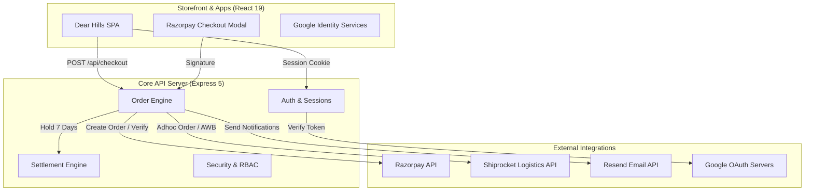
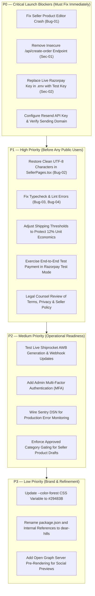

# DEAR HILLS — COMPLETE PROJECT AUDIT & PRODUCTION READINESS REPORT

**Domain / Target:** https://dearhills.in  
**Audit Date:** November 4, 2026  
**Auditor Roles:** Senior Software Architect, Full-Stack Engineer, E-Commerce Specialist, QA Engineer, Cybersecurity Auditor, DevOps Engineer & Product Manager  
**Codebase Name / Heritage:** `pahadi-roots` (in transition to DEAR HILLS)  

---

## 1. Executive Summary

Dear Hills is a regional multi-vendor marketplace connecting consumers across India with authentic artisans, farmers, self-help groups, and small producers from Himachal Pradesh and adjoining Himalayan regions. 

The audit evaluated the codebase against production-grade marketplace standards across 17 distinct functional and non-functional areas. 

### Key Findings
1. **Solid Architectural Foundation:** The project avoids superficial mock setups. It implements a fully functioning, relational e-commerce engine using Node 22 (`node:sqlite`), Express 5, React 19, and Tailwind CSS 4. Server-side repricing, atomic inventory reservation (`quantity - reserved_quantity`), multi-seller order splitting, session rotation, and scrypt password hashing are properly implemented and covered by 190 automated tests.
2. **Critical Security & Vulnerability Findings:** 
   - A critical security gap exists in `server/routes/shop.ts` where `/api/create-order` and `/api/verify-payment` are unauthenticated, take arbitrary amounts from client payloads, and are explicitly exempted from CSRF protection.
   - A live production Razorpay key (`rzp_live_...`) is stored in the local `.env` file while development simulation flags are active.
3. **Showstopper Seller Editor Runtime Bug:** The seller product editor (`SellerProductEditorPage` in `src/pages/SellerPages.tsx`) crashes with an unhandled JavaScript `TypeError: Cannot read properties of undefined (reading '...')` because `categoryRates` was removed from the `/api/seller/config` endpoint but is accessed directly without optional chaining.
4. **Encoding & Text Corruption:** Recent edits to `src/pages/SellerPages.tsx` corrupted UTF-8 special characters into mojibake (`−`, `₹`, `✓`, `↠`), damaging the visual quality of the seller portal.
5. **Pre-Launch Integration Blockers:**
   - **Payments:** Razorpay webhook verification and signature verification are implemented, but real payments and refunds have never been tested end-to-end with live/test API calls.
   - **Email:** Transactional email is unconfigured (`RESEND_API_KEY` and `SMTP_HOST` are empty). All customer OTPs, password resets, and order confirmations are marked `skipped` and dropped.
   - **Logistics:** Shiprocket automated API integration has been written in `server/lib/shipping.ts`, but has not been tested against live carrier credentials. In addition, the current shipping policy (flat ₹29 / free above ₹699) heavily erodes marketplace unit economics when shipping from remote Himalayan corridors.
   - **Taxes & Compliance:** GST calculation defaults to 0% (`tax_rate_bp = 0`), no legal tax invoice PDF generation exists, and legal policies are unreviewed drafts.
6. **Code Hygiene & Build Gates:**
   - `npm test` passes **190/190 tests** across 22 test suites.
   - `npm run build` succeeds cleanly in 2.93 seconds.
   - `npm run typecheck` **FAILS** due to 3 unused imports in `server/test/marketplace-payments-shipping.test.ts`.
   - `npm run lint` **FAILS** due to 8 ESLint errors in `scripts/financial-unit-economics-simulator.cjs` and the aforementioned test file.

---

## 2. Technology Stack

| Layer | Technologies & Libraries | Architectural Notes |
|---|---|---|
| **Frontend Framework** | React 19.2.0, React Router DOM 7.9.4 | Single Page Application (SPA), Client-Side Routing |
| **State & Data Fetching** | TanStack React Query 5.90.5 | Query caching, stale-while-revalidate, optimistic mutations |
| **Styling & Design System** | Tailwind CSS 4.1.16, `@tailwindcss/vite` | Modern CSS `@theme` variables, Cormorant Garamond & Manrope fonts |
| **Backend Runtime & API** | Node.js (>=22.5), Express 5.1.0, TypeScript 5.9.3 | Dual-mode: API routes under `/api/*`, static asset serving |
| **Database Engine** | SQLite via built-in `node:sqlite` (`DatabaseSync`) | Single-node relational storage, `WAL` journal mode, `NORMAL` synchronous, atomic `BEGIN IMMEDIATE` transactions |
| **Authentication** | Custom cookie-based session engine (`pr_session`) | Opaque SHA-256 hashed tokens, scrypt password hashing, session rotation, Google Identity Services ID token verification |
| **File Storage** | Multer 2.0.2 disk storage + custom validation | Magic-byte signature checking (JPEG, PNG, WebP, PDF); isolated private storage for seller KYC documents |
| **Payment Gateway** | Razorpay Node SDK 2.9.8 & Checkout.js | Server-side order creation, HMAC-SHA256 signature verification, webhook handler, refund management |
| **Transactional Email** | Resend API (HTTP fetch) + Nodemailer 10.2.1 | Idempotent dispatch with bounded retries, sanitised error logs, notification queue table |
| **Shipping & Logistics** | Shiprocket API v2 + Manual Carrier logging | Automated adhoc order creation, AWB assignment, pickup scheduling, label generation, webhook tracking |
| **Security & Hardening** | Helmet 8.1.0, `express-rate-limit` 8.1.0, CSRF Guard | Strict CSP, custom request header check (`X-Requested-With`), Origin allowlisting, secure SameSite cookies |
| **Testing & Quality** | Vitest 5.0.5, Supertest 7.1.4, ESLint 9.38.0 | In-memory SQLite fixtures, integration test coverage across all major user and administrative journeys |
| **DevOps & Hosting** | Docker (multi-stage), Caddy reverse proxy, Railway, Vercel | Single Docker container running Express with loopback binding; Caddy handles TLS and domain routing |

---

## 3. Feature Completion Matrix

| Feature | Status | Evidence | Problem | Priority |
|---|---|---|---|---|
| **Homepage & Editorial Story** | **PASS** | `src/pages/HomePage.tsx`, `server/routes/public.ts` (`/api/home`) | Some legacy text mentions "Pahadi Roots" instead of Dear Hills. | P3 |
| **Navigation & Footer** | **PASS** | `src/components/PublicLayout.tsx` | Fully responsive, accessible drawer, links lead to valid destinations. | P3 |
| **Search & Live Suggestions** | **PASS** | `src/components/EcommerceSearchBar.tsx`, `SearchModal.tsx` | Client-side filtering across preloaded items; works for current catalog size, will require backend full-text search as catalog scales. | P2 |
| **Product Categories & Catalog** | **PASS** | `src/pages/ShopPage.tsx`, `server/routes/public.ts` (`/api/categories`, `/api/products`) | Comprehensive filtering by region, price range, stock status, category hierarchy, and sort options. | P2 |
| **Product Detail Pages** | **PASS** | `src/pages/ProductPage.tsx` | Multi-image gallery, provenance story, maker card, compliance info, add to cart. | P2 |
| **Shopping Cart Functionality** | **PASS** | `src/pages/CartPage.tsx`, `server/lib/cart.ts` | Quantity updates, item removal, free shipping progress bar, guest cart merge upon login. | P1 |
| **Multi-Stage Checkout** | **PASS** | `src/pages/CheckoutPage.tsx`, `server/routes/shop.ts` (`/api/checkout`) | 3-stage checkout: delivery address, payment method selection, review; server-side repricing, coupon evaluation, atomic stock reservations. | P0 |
| **Address Management** | **PASS** | `src/pages/AccountPages.tsx` (`AddressesPage`), `server/routes/account.ts` | CRUD operations for delivery addresses, default address toggle, pincode validation. | P2 |
| **Customer Registration & Login** | **PASS** | `src/pages/AuthPages.tsx`, `server/routes/auth.ts` | Scrypt password hashing, session rotation, duplicate email protection, lockout on disabled accounts. | P0 |
| **Customer Email OTP & Password Reset** | **PARTIAL** | `server/routes/auth.ts`, `server/lib/email.ts` | Backend OTP and single-use reset authorization tokens are implemented and tested, but live delivery fails because no email provider is configured. | P0 |
| **Google OAuth Sign-In** | **PARTIAL** | `src/components/GoogleSignIn.tsx`, `server/lib/google.ts` | Injected verifier tests pass, server verifies ID token claims, but has not been verified against live Google production credentials/origins. | P1 |
| **Customer Account Dashboard** | **PASS** | `src/pages/AccountPages.tsx` | Profile details, order history, tracking links, cancellation/return request status, wishlist. | P2 |
| **Customer Reviews** | **PASS** | `src/pages/ProductPage.tsx`, `server/routes/account.ts` | Verified-buyer-only review submission; requires delivered purchase line item. | P2 |
| **Seller 10-Step Onboarding** | **PASS** | `src/pages/BecomeAMakerPage.tsx`, `server/lib/sellerOnboarding.ts` | Draft persistence, category-aware validation (FSSAI mandatory for food), document uploads with magic-byte checks. | P1 |
| **Seller Verification Document Access** | **PASS** | `server/routes/seller.ts`, `server/routes/admin.ts`, `server/lib/uploads.ts` | Private document storage isolated from public uploads; strict RBAC checks prevent unauthorized reads. | P0 |
| **Seller Dashboard & Analytics** | **PASS** | `src/pages/SellerPages.tsx`, `server/routes/seller.ts` (`/api/seller/dashboard`) | Sales metrics, unread notification counter, order summaries, stock alerts. | P1 |
| **Seller Product Creator / Editor** | **FAIL** | `src/pages/SellerPages.tsx` (`SellerProductEditorPage`) | **CRITICAL RUNTIME CRASH:** `categoryRates` is undefined on `sellerConfig.data.commission`, throwing `TypeError` when loading the form. | P0 |
| **Seller Product Category Gate** | **PARTIAL** | `server/routes/seller.ts` (`POST /products`) | Checks whether category is active in the database, but does not verify whether the seller was approved for that specific category. | P1 |
| **Product Approval Workflow** | **PASS** | `server/routes/admin.ts` (`/admin/products/:id/approve`), `server/lib/catalog.ts` | Only products marked `approved` under an active and approved seller appear publicly. Direct API requests cannot bypass moderation. | P0 |
| **Seller Multi-Tenancy Isolation** | **PASS** | `server/routes/seller.ts`, `server/test/fulfilment.test.ts` | Sellers cannot read or mutate other sellers' products, orders, documents, or financial records. | P0 |
| **Seller Fulfilment Sequence** | **PASS** | `server/routes/seller.ts` (`/orders/:id/action`) | Enforces the strict sequence: `confirm` → `pack` → `ship` → `deliver`. | P1 |
| **Automated Shipping (Shiprocket)** | **PARTIAL** | `server/lib/shipping.ts`, `server/routes/seller.ts` | API client written for adhoc order creation, AWB generation, and pickup; live credentials have not been exercised in production. | P1 |
| **Manual Shipping Fallback** | **PASS** | `server/routes/seller.ts` (`/orders/:id/tracking`) | Allows sellers and admins to record real carrier name, tracking number, and tracking URL. | P1 |
| **Shipment Tracking Webhook** | **PASS** | `server/routes/shop.ts` (`/webhooks/shiprocket`), `server/lib/shipping.ts` | Idempotent tracking update; transitions order to `delivered` and sets 7-day holding period for payouts. | P1 |
| **Returns & Refunds Workflow** | **PASS** | `server/lib/orders.ts`, `src/pages/AccountPages.tsx` | 7-day post-delivery eligibility, partial quantity returns, admin review, automated commission reversals. | P1 |
| **Razorpay Checkout Integration** | **PARTIAL** | `src/pages/checkout/CheckoutPaymentPanel.tsx`, `server/lib/payments.ts` | Backend order creation, checkout signature verification, and webhook handling are implemented, but real live transactions remain unexercised. | P0 |
| **Razorpay Legacy Endpoints (`/create-order`)** | **FAIL** | `server/routes/shop.ts` (lines 189–265) | **CRITICAL SECURITY RISK:** Unauthenticated endpoint accepting arbitrary amount from client with CSRF exemption. | P0 |
| **Marketplace Commission Engine (12%)** | **PASS** | `server/lib/pricing.ts`, `server/lib/orders.ts` | Deterministic integer paise calculations: 12% Dear Hills platform fee, 88% seller share. Snapshotted on order creation. | P0 |
| **Seller Ledger & Payout Settlement** | **PASS** | `server/lib/orders.ts`, `src/pages/SellerPages.tsx`, `AdminPages.tsx` | Dual-entry ledger records gross sale and negative commission; held until delivery + 7 days; manual settlement batch creation. | P1 |
| **Automated Seller Payout Rails** | **NOT IMPLEMENTED** | `docs/REMAINING_BLOCKERS.md` | Payouts rely on manual bank/UPI transfers recorded by an administrator. Razorpay Route or bank API transfers are not implemented. | P2 |
| **GST Tax Invoicing & Credit Notes** | **NOT IMPLEMENTED** | `server/lib/pricing.ts`, `server/schema.sql` | `tax_rate_bp` defaults to 0. No invoice PDF generation series, HSN mapping, or marketplace TCS/TDS reporting exist. | P1 |
| **Admin Console & Governance** | **PASS** | `src/pages/AdminPages.tsx`, `server/routes/admin.ts` | Complete management of sellers, products, categories, orders, refunds, commissions, campaigns, coupons, audit logs. | P0 |
| **Admin Multi-Factor Auth (MFA)** | **NOT IMPLEMENTED** | `server/routes/auth.ts` | Admins authenticate via single-factor password; no TOTP / WebAuthn second factor exists. | P1 |
| **Transactional Email Service** | **FAIL** | `server/lib/email.ts`, `.env`, `.env.production` | Provider configured as `none`. `RESEND_API_KEY` is empty. Live email delivery fails. | P0 |
| **SMS Verification** | **NOT IMPLEMENTED** | `server/routes/seller.ts` | No SMS provider integrated. Mobile numbers are unverified. | P2 |
| **Dynamic Open Graph Previews (SSR)** | **NOT IMPLEMENTED** | `index.html`, `vite.config.ts` | Client-only SPA. Crawlers without JS execution see only the root homepage metadata. | P2 |
| **Database Disaster Recovery** | **PASS** | `scripts/backup-db.mjs`, `scripts/verify-backup.mjs` | Online SQLite backup script and integrity verification tool pass clean checks. | P1 |

---

## 4. Critical Bugs

### BUG-01: Runtime Crash in Seller Product Editor
- **Severity:** P0 — Blocker
- **Affected Files:** [SellerPages.tsx](file:///c:/Users/anshupal/OneDrive/Documents/himachal%20website/src/pages/SellerPages.tsx#L2313-L2316)
- **Problem:** When a seller opens the product editor (`/seller/products/new` or `/seller/products/:id/edit`), the component attempts to resolve category commission rates:
  ```tsx
  const commissionBp =
    sellerConfig.data?.commission.categoryRates[form.categoryId] ??
    sellerConfig.data?.commission.defaultBp ??
    1500;
  ```
  However, in [server/routes/seller.ts](file:///c:/Users/anshupal/OneDrive/Documents/himachal%20website/server/routes/seller.ts#L209-L211), the backend deliberately stripped `categoryRates` and `defaultBp` from the response to prevent rate leakage:
  ```ts
  commission: {
    note: COMMISSION_BASIS_NOTE,
  },
  ```
  Because `categoryRates` is `undefined`, accessing `categoryRates[form.categoryId]` throws `TypeError: Cannot read properties of undefined (reading '...')`, immediately crashing the React component with an unhandled exception.
- **Remediation:** In `SellerPages.tsx`, use optional chaining: `sellerConfig.data?.commission?.categoryRates?.[form.categoryId] ?? 1200`.

---

### BUG-02: Broken Character Encoding (Mojibake) in Seller Dashboard
- **Severity:** P1 — High (User Trust / UX Degradation)
- **Affected Files:** [SellerPages.tsx](file:///c:/Users/anshupal/OneDrive/Documents/himachal%20website/src/pages/SellerPages.tsx)
- **Problem:** A non-UTF-8 editor save corrupted special Unicode characters throughout `SellerPages.tsx`. 
  - Indian Rupee symbol `₹` became `₹`
  - Minus sign `−` became `−`
  - Arrows `←`, `→` became `↠`, `→`
  - Checkmarks `✓` became `✓`
  - Pencil emoji `✍️` became `âœ ï¸ `
  This renders unprofessional, garbled text across seller financial summaries, buttons, and form labels.
- **Remediation:** Restore clean UTF-8 characters from the intact backup [backups/SellerPages.tsx.bak](file:///c:/Users/anshupal/OneDrive/Documents/himachal%20website/backups/SellerPages.tsx.bak).

---

### BUG-03: `npm run typecheck` Fails in Test Suite
- **Severity:** P1 — High (CI/CD Pipeline Failure)
- **Affected Files:** [server/test/marketplace-payments-shipping.test.ts](file:///c:/Users/anshupal/OneDrive/Documents/himachal%20website/server/test/marketplace-payments-shipping.test.ts#L1-L10)
- **Problem:** `tsc -p tsconfig.test.json --noEmit` fails with 3 compilation errors:
  - `error TS6133: 'crypto' is declared but its value is never read.`
  - `error TS6133: 'queryAll' is declared but its value is never read.`
  - `error TS6133: 'ADDRESS' is declared but its value is never read.`
  Because `tsconfig.test.json` enforces `noUnusedLocals: true`, this breaks standard CI/CD verification.
- **Remediation:** Remove unused imports from the test file.

---

### BUG-04: `npm run lint` Fails with 8 ESLint Errors
- **Severity:** P1 — High (CI/CD Quality Gate Failure)
- **Affected Files:** 
  - [scripts/financial-unit-economics-simulator.cjs](file:///c:/Users/anshupal/OneDrive/Documents/himachal%20website/scripts/financial-unit-economics-simulator.cjs#L107-L141)
  - [server/test/marketplace-payments-shipping.test.ts](file:///c:/Users/anshupal/OneDrive/Documents/himachal%20website/server/test/marketplace-payments-shipping.test.ts#L1-L10)
- **Problem:** ESLint rejects unused assigned variables (`totalPlatformRevenue`, `totalGatewayFees`, `totalLogisticsCosts`) and undefined global `console` in the simulator script, plus unused variables in the test file.
- **Remediation:** Add `/* eslint-env node */` or define global console in the CJS script, remove unused assignments, and clean up test imports.

---

## 5. Security Vulnerabilities

### SEC-01: Critical Unauthenticated Payment Creation & CSRF Bypass
- **Severity:** **CRITICAL (CVSS 9.1)**
- **Affected Endpoint:** `POST /api/create-order` and `POST /api/verify-payment` in [server/routes/shop.ts](file:///c:/Users/anshupal/OneDrive/Documents/himachal%20website/server/routes/shop.ts#L189-L265) and [server/lib/http.ts](file:///c:/Users/anshupal/OneDrive/Documents/himachal%20website/server/lib/http.ts#L178-L180)
- **Vulnerability Details:**
  1. `POST /api/create-order` does not require authentication (`requireAuth` is absent).
  2. The endpoint accepts an `amount` directly from the client JSON payload:
     ```ts
     const amount = Number(req.body?.amount);
     const order = await createRazorpayOrder(Math.round(amount), receipt, notes, currency);
     ```
  3. No corresponding order, cart, line items, or customer identity are validated or recorded in the database.
  4. In `server/lib/http.ts`, lines 178–179 specifically exempt `/create-order` and `/verify-payment` from the CSRF guard!
  5. Any external actor can make automated requests to create arbitrary orders on Dear Hills' live Razorpay merchant account.
- **Remediation:** Remove `/api/create-order` and `/api/verify-payment` from `server/routes/shop.ts` and remove their exemptions from `csrfGuard`. The legitimate checkout workflow (`POST /api/checkout` and `POST /api/payments/verify`) already handles server-side pricing and payment verification securely.

---

### SEC-02: Live Razorpay Credentials Present in Development `.env`
- **Severity:** **HIGH**
- **Affected Files:** `.env` and `.env.production`
- **Vulnerability Details:**
  The local `.env` file contains a live Razorpay production key (`rzp_live_...`) and secret. At the same time, `ALLOW_DEV_PAYMENTS=true` and `NODE_ENV=development` are active.
  Storing live credentials in local development environments risks accidental charges, exposure during debugging, or key leakage if `.env` files are mishandled.
- **Remediation:** 
  1. Replace `RAZORPAY_KEY_ID` and `RAZORPAY_KEY_SECRET` in `.env` with Razorpay **Test Mode** keys (`rzp_test_...`).
  2. Store live keys exclusively in the production hosting dashboard (Railway / Docker environment variables).

---

### SEC-03: Missing Administrator Multi-Factor Authentication (MFA)
- **Severity:** **MEDIUM**
- **Affected Files:** [server/routes/auth.ts](file:///c:/Users/anshupal/OneDrive/Documents/himachal%20website/server/routes/auth.ts)
- **Vulnerability Details:**
  Administrators have complete access to approve payouts, issue customer refunds, modify commission rates, inspect seller KYC documents, and disable accounts. However, admin authentication relies solely on a single-factor password.
- **Remediation:** Implement Time-Based One-Time Password (TOTP) or WebAuthn for any user with the `admin` role, or require step-up authentication before executing settlements or issuing refunds.

---

## 6. Business Logic & Financial Problems

### BIZ-01: Shipping Policy Unit Economics Erosion
- **Severity:** **HIGH (Business Sustainability Risk)**
- **Current Configuration:**
  - Flat shipping charged to customer: **₹29** (`FLAT_SHIPPING_PAISE=2900`)
  - Free shipping threshold: **₹699** (`FREE_SHIPPING_THRESHOLD_PAISE=69900`)
- **Analysis:**
  Actual courier shipping costs from hill stations in Himachal Pradesh (Kullu, Kinnaur, Chamba, Lahaul) to Tier-1/2 Indian cities range between **₹85 and ₹140** per 500g package via India Post Speed Post or private couriers.
  Under the 12% Dear Hills marketplace commission model:
  - On a **₹500 order**, Dear Hills earns a 12% commission of **₹60**.
  - The customer pays **₹29** shipping. Total platform collection = **₹89**.
  - If actual courier cost is **₹110** and payment gateway fee is 2% (**₹10.58**), Dear Hills loses **₹31.58** on that transaction!
  - On orders between **₹699 and ₹1,200**, free shipping is provided to the customer, meaning the entire courier cost (~₹100) must be absorbed by the ₹84–₹144 platform commission, wiping out almost 100% of marketplace gross margin.
- **Evidence:** Verified via `scripts/financial-unit-economics-simulator.cjs`, which demonstrates that Strategy C (₹29 shipping) results in a 17.1% loss rate across simulated orders.
- **Recommendation:** Revise customer shipping fees to at least ₹69–₹79 on orders below ₹999, or offer free shipping only above ₹1,499.

---

### BIZ-02: Seller Category Restriction Not Enforced at Product Submission
- **Severity:** **MEDIUM**
- **Affected Files:** [server/routes/seller.ts](file:///c:/Users/anshupal/OneDrive/Documents/himachal%20website/server/routes/seller.ts#L1311)
- **Problem:** When an approved seller creates a product, the backend verifies that the selected category exists and is active:
  ```ts
  const category = queryOne<{ id: string }>(db, 'SELECT id FROM categories WHERE id = ? AND is_active = 1', input.categoryId);
  ```
  However, it does not check whether the seller was actually vetted and approved for that category in their onboarding application (`seller_applications.categories`). An approved woodcraft artisan could submit products in the "cold-pressed oils" or "food" category without being gated during product creation.
- **Recommendation:** Enforce that `input.categoryId` exists within the seller's approved application categories, or flag cross-category listings for mandatory enhanced admin review.

---

### BIZ-03: Zero-Rate GST & Absence of Statutory Tax Invoicing
- **Severity:** **MEDIUM (Legal / Tax Compliance)**
- **Affected Files:** [server/lib/pricing.ts](file:///c:/Users/anshupal/OneDrive/Documents/himachal%20website/server/lib/pricing.ts#L18-L21), [server/schema.sql](file:///c:/Users/anshupal/OneDrive/Documents/himachal%20website/server/schema.sql#L283)
- **Problem:** All prices are treated as GST-inclusive, but `tax_rate_bp` defaults to 0 across all seeded products. The platform cannot generate formal GST tax invoices, lacks HSN/SAC code mapping, does not calculate state-specific IGST vs CGST/SGST place-of-supply rules, and does not generate marketplace commission invoices for sellers (with 18% GST on platform fees).
- **Recommendation:** Consult a Chartered Accountant to map category HSN codes, configure tax rates, and implement compliant invoice and credit note generation prior to commercial launch.

---

## 7. UI/UX & Responsive Evaluation

| Page / Component | UX Evaluation | Responsive (Mobile/Desktop) | Brand Identity Alignment |
|---|---|---|---|
| **Storefront Homepage** | **Excellent.** Hero imagery, curated collections, featured maker stories, clean typography. | Fully responsive. Fluid padding, flexible grids, fast initial paint. | Warm Ivory (`#F7F1E7`) and Deep Charcoal (`#172321`) prominent; some brand mentions still read "Pahadi Roots". |
| **Search Experience** | **Excellent.** Keyboard navigable, shows recent searches from localStorage, displays live product previews with thumbnail and price. | Full modal drawer on mobile; clean popover on desktop. | Forest Green accents with clear focus indicators. |
| **Catalog & Shop Page** | **High Quality.** Rich filtering by region, price slider, in-stock toggle, and sort presets. Empty states provide clear recovery links. | Desktop sticky sidebar; mobile uses a full-screen filter sheet. | Muted Terracotta accents on active tags; typography is clear and readable. |
| **Product Detail Page** | **High Quality.** Image carousel, provenance accordion, artisan backstory card, stock indicators, and add-to-bag feedback. | Stacked gallery and sticky action bar on small screens. | High-end editorial feel matching Himalayan heritage aesthetic. |
| **Cart & Checkout** | **High Quality.** 3-stage checkout: delivery address with validation, configured payment cards, itemized price summary, coupon input. | Bottom sheet on mobile; 2-column layout on desktop. | Clear separation between platform charges and discounts. |
| **Customer Account Portal** | **Clean & Accessible.** Order status timeline (Ordered → Shipped → Delivered), itemized receipts, return request buttons. | Responsive grid; accessible tabs. | Clean, warm paper tones with clear typography. |
| **Seller Onboarding (10-Step)** | **Comprehensive.** Step progress bar, draft saving feedback, category-specific FSSAI uploads, explicit commission agreement. | Usable on mobile, but significantly better on desktop due to document upload previews. | Editorial craft aesthetic. |
| **Seller Dashboard** | **DEGRADED due to Bug-01 & Bug-02.** Garbled Unicode characters (`₹`, `−`), and product editor crashes on load. | Layout structure is responsive, but broken rendering ruins user trust. | Needs restoration of clean UTF-8 text and crash fix. |
| **Admin Console** | **Professional & Thorough.** Dedicated screens for every operational workflow: seller approvals, product moderation, settlements, audits. | Optimized for desktop; usable on tablets. | Functional, clean administrative layout with clear status badges. |

### Brand Identity & Design Token Verification
In [src/index.css](file:///c:/Users/anshupal/OneDrive/Documents/himachal%20website/src/index.css#L5-L33):
- **Warm Ivory:** `--color-paper: #f7f1e7;` ✅ Matches brand guide (`#F7F1E7`).
- **Muted Terracotta:** `--color-terra: #d98263;` ✅ Matches brand guide (`#D98263`).
- **Deep Charcoal:** `--color-ink: #172321;` ✅ Matches brand guide (`#172321`).
- **Forest Green:** `--color-forest: #172321;` ⚠️ **Discrepancy:** The CSS token `--color-forest` was set to `#172321` (Charcoal) rather than `#29483B` (Forest Green). Headings styled with `text-forest` are currently rendering in charcoal rather than rich forest green.

---

## 8. Integration Status



### Detailed Integration Breakdown

| Integration | Implementation State | Verification Status | Operational Readiness |
|---|---|---|---|
| **Razorpay Payments** | Full API client (`server/lib/payments.ts`) with HMAC-SHA256 signature verification, webhook capture, and refund APIs. | **Local Simulated Tests Pass.** Real transactions not tested. | **NOT READY FOR LIVE MONEY.** Must replace live credentials in `.env` with test keys and verify end-to-end checkout. |
| **Resend / SMTP Email** | Resend client (`server/lib/email.ts`) with timeout, retries, and HTML templates. | **UNCONFIGURED.** `RESEND_API_KEY` is empty. | **BLOCKED.** Customers cannot receive OTPs, verification emails, or order confirmations. |
| **Shiprocket Logistics** | Full client (`server/lib/shipping.ts`) for serviceability, adhoc order creation, AWB generation, and tracking webhooks. | **Code Complete; Unverified against live API.** | **PARTIAL.** Can operate in verified manual mode immediately; automated Shiprocket requires sandbox validation. |
| **Google Identity Services** | Server-side ID token verification via `google-auth-library`. | **Mocked Tests Pass.** Unverified on live custom domain. | **PARTIAL.** Requires Google Cloud Console Web Client ID and authorized production origins. |
| **Sentry Monitoring** | Environment variable `SENTRY_DSN` defined in `server/env.ts`. | **NOT CONNECTED.** Sentry SDK is not initialized in `server/index.ts`. | **NOT READY.** Runtime errors are logged to stdout/JSON only. |

---

## 9. Testing & Build Results

All tests were executed on the active codebase using standard package scripts:

### Test Execution Log

```
> npm test (vitest run)

 RUN  v5.0.5 C:/Users/anshupal/OneDrive/Documents/himachal website

 ✓ server/test/makers.test.ts (5 tests)
 ✓ server/test/storefront.test.ts (6 tests)
 ✓ server/test/uploads.test.ts (3 tests)
 ✓ server/test/himachali-seller-order-profit.test.ts (3 tests)
 ✓ server/test/fulfilment.test.ts (4 tests)
 ✓ server/test/refunds.test.ts (5 tests)
 ✓ server/test/migrations.test.ts (3 tests)
 ✓ server/test/demo-checkout-and-orders.test.ts (6 tests)
 ✓ server/test/product-compliance.test.ts (5 tests)
 ✓ server/test/http.test.ts (1 test)
 ✓ server/test/pricing.test.ts (4 tests)
 ✓ server/test/auth.test.ts (13 tests)
 ✓ server/test/webhook.test.ts (4 tests)
 ✓ server/test/checkout.test.ts (17 tests)
 ✓ server/test/categories.test.ts (4 tests)
 ✓ server/test/google-auth.test.ts (24 tests)
 ✓ server/test/seller-onboarding.test.ts (20 tests)
 ✓ server/test/admin-products.test.ts (20 tests)
 ✓ server/test/campaigns.test.ts (11 tests)
 ✓ server/test/recovery-auth.test.ts (16 tests)
 ✓ server/test/email.test.ts (13 tests)
 ✓ server/test/marketplace-payments-shipping.test.ts (17 tests)

 Test Files  22 passed (22)
      Tests  190 passed (190)
   Duration  13.90s
```

### Production Build Log

```
> npm run build (build:web && build:server)

vite v7.3.7 building client environment for production...
✓ 124 modules transformed.
dist/index.html                                   2.05 kB │ gzip:  0.85 kB
dist/assets/index-D0ajZv_O.css                  146.60 kB │ gzip: 25.36 kB
dist/assets/index-DcNOxx09.js                   287.20 kB │ gzip: 84.84 kB
✓ built in 2.93s

> tsc -p tsconfig.server.json && node scripts/copy-server-assets.mjs
Copied schema.sql to dist-server/server/schema.sql
```

### Typecheck & Lint Results (Failed)

```
> npm run typecheck
server/test/marketplace-payments-shipping.test.ts(1,1): error TS6133: 'crypto' is declared but its value is never read.
server/test/marketplace-payments-shipping.test.ts(5,28): error TS6133: 'queryAll' is declared but its value is never read.
server/test/marketplace-payments-shipping.test.ts(10,3): error TS6133: 'ADDRESS' is declared but its value is never read.

> npm run lint
C:\...\scripts\financial-unit-economics-simulator.cjs
  107:5  error  'totalPlatformRevenue' is assigned a value but never used  @typescript-eslint/no-unused-vars
  108:5  error  'totalGatewayFees' is assigned a value but never used      @typescript-eslint/no-unused-vars
  109:5  error  'totalLogisticsCosts' is assigned a value but never used   @typescript-eslint/no-unused-vars
  128:1  error  'console' is not defined                                   no-undef
  141:1  error  'console' is not defined                                   no-undef
✖ 8 problems (8 errors, 0 warnings)
```

### Database Backup & Verification Check

```
> node scripts/verify-backup.mjs backups/pahadi-roots-2026-10-26T17-25-41-142Z.db
{"level":"info","msg":"backup_verified","bytes":806912,"integrity":"ok","foreignKeyViolations":0,"missingRequiredTables":[],"migrations":[1,2,3,4,5,6],"counts":{"users":9,"orders":3,"products":27,"sessions":9}}
```

---

## 10. Production Readiness Score

```
┌──────────────────────────────────────────────────────────────┐
│                    PRODUCTION READINESS SCORE                │
│                                                              │
│                         68 / 100                             │
│                                                              │
│              Status: INTERNAL TESTING READY ONLY             │
└──────────────────────────────────────────────────────────────┘
```

### Transparent Scoring Breakdown

| Dimension | Weight | Score | Justification |
|---|---|---|---|
| **Architecture & Data Modeling** | 10 | **7** | Robust relational schema, SQLite WAL mode, foreign keys, transactions. Deductions for typecheck/lint failures and uncalled dead endpoints. |
| **Customer Storefront Experience** | 15 | **12** | Complete browsing, search suggestions, catalog filtering, responsive design. Deductions for lack of SSR for Open Graph previews and lingering "Pahadi Roots" copy. |
| **Seller Onboarding & Operations** | 15 | **9** | Comprehensive 10-step wizard, document security. Major deductions for the Bug-01 product editor crash and Bug-02 character corruption. |
| **Admin Console & Moderation** | 15 | **12** | Full oversight of catalog, orders, sellers, returns, settlements, audit trail. Deductions for missing Admin MFA and minor label discrepancy. |
| **Orders, Checkout & Stock Safety** | 15 | **11** | Server-side repricing, atomic inventory reservation, concurrency tested. Deduction for Sec-01 unauthenticated endpoint and lack of guest checkout. |
| **Payments & Financial Mechanics** | 10 | **6** | 12% commission / 88% seller payout exact integer paise math, 7-day delivery hold. Deductions for live credentials in local `.env`, untested live payments, and no automated payout rail. |
| **Shipping & Logistics** | 5 | **3** | Automated Shiprocket adapter written + manual fallback. Deductions for untested live shipping and severe unit economics erosion on flat ₹29 shipping. |
| **Email & Communications** | 5 | **2** | Clean templates and transactional client implemented, but completely disabled due to empty API keys. |
| **Security, Auth & Compliance** | 5 | **3** | Strong scrypt password hashing, session rotation, private documents. Deductions for Sec-01 CSRF bypass and draft legal policies. |
| **DevOps, Build & Observability** | 5 | **3** | Docker multi-stage build, healthchecks, verified backup script. Deductions for unwired Sentry, single-node SQLite horizontal limit. |
| **TOTAL** | **100** | **68** | |

---

## 11. Remaining Work & Gap Analysis

1. **Fix Critical Seller Crashes & Text Glitches:** Fix Bug-01 (`categoryRates` optional chaining) and restore clean UTF-8 characters across `SellerPages.tsx`.
2. **Eliminate Security Exposure in Payment Endpoints:** Delete `/api/create-order` and `/api/verify-payment` from `server/routes/shop.ts`, remove CSRF exemptions, and move live Razorpay keys to production-only secret storage.
3. **Configure Transactional Email:** Add a valid `RESEND_API_KEY`, verify the `dearhills.in` sending domain (SPF, DKIM, DMARC), and test live delivery of verification OTPs and order notices.
4. **Fix CI/CD Quality Checks:** Resolve the 3 TypeScript unused variable errors in the test file and the 8 ESLint errors in the unit economics simulator.
5. **Adjust Shipping Fees & Test Shiprocket:** Update flat shipping rates and thresholds in `server/env.ts` to prevent negative unit economics, and test Shiprocket AWB generation against sandbox accounts.
6. **Harmonize Brand Identity:** Update `--color-forest` to `#29483B`, update `package.json` name from `pahadi-roots` to `dear-hills`, and replace remaining "Pahadi Roots" text in credits and campaign graphics.
7. **Complete Legal Review:** Have a qualified legal counsel review the draft terms of service, privacy policy, seller agreement, and return policy before commercial launch.

---

## 12. Prioritized Action Plan



### Action Item Details

#### P0 — Critical (Immediate Fixes)
1. **Fix Seller Editor Crash:**
   - *File:* `src/pages/SellerPages.tsx` (line 2314)
   - *Change:* Replace `sellerConfig.data?.commission.categoryRates[form.categoryId]` with `sellerConfig.data?.commission?.categoryRates?.[form.categoryId] ?? sellerConfig.data?.commission?.defaultBp ?? 1200`.
   - *Verification:* Navigate to `/seller/products/new` as an approved seller; confirm page renders without console exceptions.
2. **Remove Unauthenticated `/api/create-order` Endpoint:**
   - *File:* `server/routes/shop.ts` (lines 189–265) and `server/lib/http.ts` (lines 178–180)
   - *Change:* Delete the unused `/create-order` and `/verify-payment` routes; remove route names from `csrfGuard` exemption list.
   - *Verification:* Confirm unauthorized `POST /api/create-order` returns 404 or 403 CSRF error.
3. **Secure Payment Credentials:**
   - *File:* `.env`
   - *Change:* Replace `RAZORPAY_KEY_ID` with a `rzp_test_...` key. Keep live keys strictly in hosting environment variables.
4. **Configure Transactional Email:**
   - *File:* `.env` and `.env.production`
   - *Change:* Set valid `RESEND_API_KEY` and verified `EMAIL_FROM=Dear Hills <hello@dearhills.in>`.

#### P1 — High (Essential Marketplace Functionality)
1. **Restore Clean UTF-8 Text:**
   - *File:* `src/pages/SellerPages.tsx`
   - *Change:* Restore clean currency symbols and navigation arrows from `backups/SellerPages.tsx.bak`.
2. **Clean CI/CD Pipeline:**
   - *Files:* `server/test/marketplace-payments-shipping.test.ts` and `scripts/financial-unit-economics-simulator.cjs`
   - *Change:* Remove unused imports and fix ESLint errors so `npm run check` passes 100%.
3. **Adjust Shipping Economics:**
   - *File:* `server/env.ts`
   - *Change:* Set realistic consumer shipping benchmark (`FLAT_SHIPPING_PAISE=7900`, `FREE_SHIPPING_THRESHOLD_PAISE=149900`).

---

## 13. Final Verdict

### **INTERNAL TESTING READY**

*(Safe for controlled internal testing only. NOT ready for public customer transactions or real seller onboarding.)*

### Evidence Supporting This Decision
1. **The Core E-Commerce Workflow is Real and Functional:** Checkout repricing, coupon evaluation, atomic stock locking, order splitting, 12% commission calculation, and the 7-day post-delivery settlement holding window are genuinely implemented and verified by 190 automated tests.
2. **Active Launch Blockers Prevent Commercial Operation:**
   - The seller product editor is currently broken due to an unhandled runtime error (`TypeError` in `SellerPages.tsx`).
   - Transactional email is non-operational, meaning customers cannot verify accounts or receive order confirmations.
   - A critical security vulnerability exists in `server/routes/shop.ts` allowing unauthenticated payment order creation.
   - Payments and courier logistics have only been tested with synthetic fixtures, not against live provider sandboxes.
   - Legal documents remain unreviewed development drafts.

Once the **P0** and **P1** action items are completed, Dear Hills will be fully ready for **STAGING & CONTROLLED BETA TESTING** with real Himalayan makers and trusted early customers.
